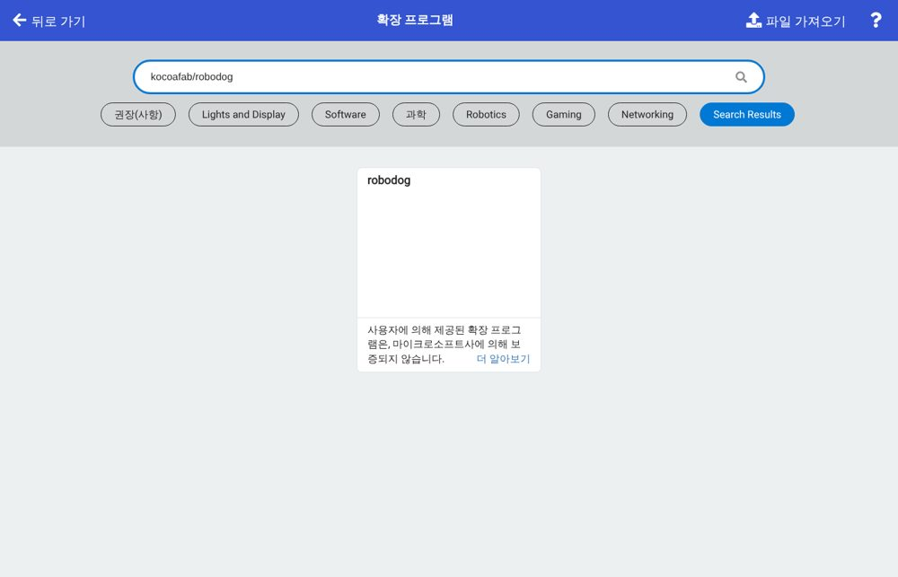
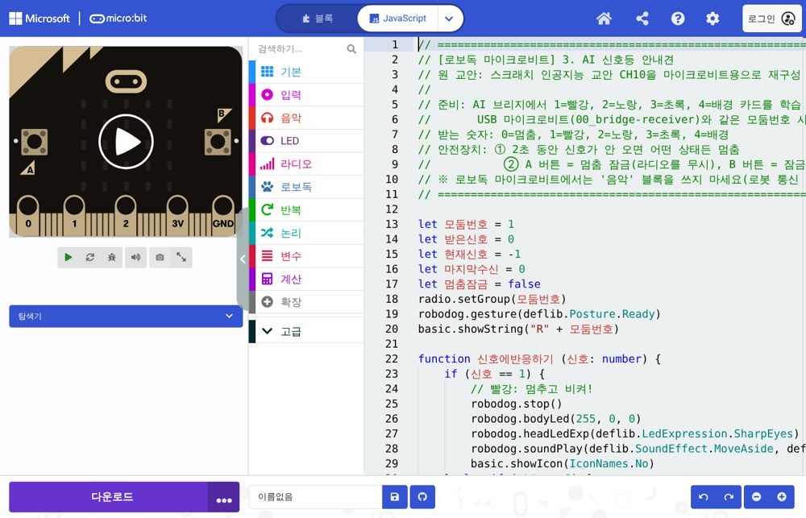
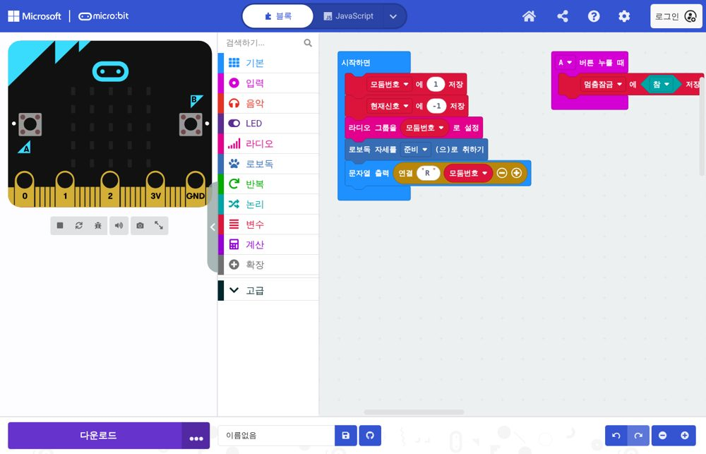

# 예제 따라 하기 — 본체 버튼 · 라디오 리모컨 (처음 하는 분용)

로보독을 처음 만지는 분도 **위에서부터 순서대로** 하면 되도록 썼어요.

> **먼저 알아 두기** — 새로 넣은 예제(10, 12, 20, 21, 22, 23)는 시뮬레이터에서만 확인했어요. 수업에 쓰기 전에 실물 로보독에서 한 번 해 보세요. 걷는 예제는 항상 **바닥**에서 해요.

**처음이면 이 순서로 보세요:** 이 문서(시뮬레이터 → 실물) → [블록 한눈표](10_블록_한눈표.md)(내 아이디어 만들기) → [운영 가이드](05_교사용_운영가이드.md)(수업 준비).

## 미리 알면 좋은 말

| 말 | 뜻 |
|---|---|
| 마이크로비트 | 로보독 등에 꽂는 작은 컴퓨터. 로보독의 **두뇌**예요 |
| MakeCode(메이크코드) | 마이크로비트에 넣을 코드를 블록으로 만드는 웹사이트 |
| 확장 | MakeCode에 **로보독 블록 꾸러미**를 더하는 것. 한 프로젝트에 한 번만 하면 돼요 |
| 다운로드 / .hex 파일 | 만든 코드를 마이크로비트에 넣는 일 / 그때 생기는 파일 |
| 본체 버튼 | 로보독 아래쪽 **전원 스위치 옆 작은 버튼** |
| 라디오 | 마이크로비트끼리 **숫자를 주고받는 전파**(인터넷 필요 없음) |
| 모둠 번호 | 라디오의 **채널 번호**(코드에서는 라디오 그룹). 같은 번호끼리만 들려요 |
| 변수 | 숫자를 담아 두는 **이름표 상자**(예: `모둠번호`, `가까움기준`) |
| AI 브리지 | 카메라로 카드를 알아보고, 그 결과를 숫자로 로보독에 보내 주는 웹 화면 |

## 예제는 두 갈래

| 갈래 | 필요한 것 | 어떻게 시작하나 |
|---|---|---|
| 🔘 **본체 버튼으로 해 보기** | 로보독 + 마이크로비트 **1개** | 로보독의 **본체 버튼**을 누르면 시작 |
| 📡 **라디오 리모컨으로 해 보기** | 로보독 + 마이크로비트 **2개**(하나는 손에 드는 리모컨) | 리모컨의 A·B 버튼을 누르면 숫자가 날아가 로보독이 움직임 |

> 왜 마이크로비트의 A·B 버튼을 안 쓰나요? 로보독 등에 꽂으면 A·B 버튼이 가려져 누를 수 없어요. 그래서 로보독에서는 **본체 버튼**을, 멀리서 조종할 때는 **리모컨(두 번째 마이크로비트)**을 써요.

## 0. 먼저 시뮬레이터에서 해 보기 (로보독이 없어도 돼요)

1. 사이트 위쪽 **[시뮬레이터]**를 엽니다.
2. **② 코드** 옆의 **[예제 고르기]** 상자를 누르면 🔘 본체 버튼 / 📡 라디오 리모컨 / 🛠 점검으로 나뉘어 있어요.
3. 예제를 고르면 바로 아래에 **"따라 하기"** 상자가 나와요. 적힌 순서대로 누르면 돼요.
4. 실행은 **[▶ 실행]**, 멈춤은 **[■ 정지]**, 처음 자리로는 **[↺ 처음으로]**.
5. 버튼은 로보독 화면 **바로 위 줄**에 나와요: **[본체 버튼 누르기]**, **[📡 리모컨] 1~4**, **[🅰 마이크로비트] A·B**.
6. 공간이 좁으면 오른쪽 **환경 → 공간 크기**에서 넓게 바꿀 수 있어요. 소리는 **효과음 켜기**를 눌러야 들려요.

## 1. 실물에 코드 넣는 법 (모든 예제 공통)

**준비물:** 컴퓨터(크롬·엣지), 마이크로비트, **데이터용** USB 케이블(충전 전용 케이블은 안 돼요), 충전된 로보독.

1. <https://makecode.microbit.org> 를 열고 **새 프로젝트**를 누릅니다. 이름은 아무거나 써도 돼요.
2. **로보독 확장 넣기** (로보독 쪽 코드만. 리모컨 쪽 코드 ①에는 필요 없어요)
   1. 가운데 블록 목록 아래쪽 **확장**을 누릅니다(아래 그림 왼쪽 목록의 ⊕ 확장).
   2. 검색창에 `kocoafab/robodog` 를 **빠짐없이 전부** 입력하고 엔터. (`robodog`만 치면 안 나와요)
   3. 나온 **robodog** 카드를 한 번 누르면 블록 목록에 **로보독**이 생겨요.

   

3. **예제 코드 붙여넣기**
   1. 이 문서의 예제 파일 이름(예: `makecode/10_button-bark.ts`)을 누릅니다. 파일이 내려받아지거나 **글자 화면**으로 열려요.
   2. 글자 화면이면 **Ctrl + A**(전체 선택) → **Ctrl + C**(복사). 시뮬레이터 **글자 코드** 탭에서 복사해도 같아요.
   3. MakeCode 위쪽 가운데 **{} JavaScript**를 누르고, 안에 있던 글을 **모두 지운 뒤** **Ctrl + V**(붙여넣기).

   

4. 위쪽 **블록** 탭을 누르면 블록으로 보여요. 빨간 줄·물음표 블록이 없으면 성공이에요(있으면 2번 확장을 다시 확인).

   

5. **마이크로비트에 넣기**: 마이크로비트를 USB로 연결 → 왼쪽 아래 보라색 **다운로드**.
   - "연결" 창이 나오면 안내대로 **연결**을 누르면 바로 들어가요.
   - 연결 없이 **.hex 파일**이 내려받아지면, 파일 탐색기에서 그 파일을 **MICROBIT** 드라이브로 끌어다 놓아요. 마이크로비트 뒤쪽 불빛이 깜빡이다 멈추면 끝.
6. 로보독용이면 **로보독 전원을 끈 상태에서** 마이크로비트를 로보독 등에 **끝까지** 꽂고 전원을 켜요.

## 2. 🔘 본체 버튼 예제 (마이크로비트 1개)

| 순서 | 예제 파일 | 무엇을 하나 | 난이도 |
|---|---|---|---|
| 본체 ① | `makecode/10_button-bark.ts` | 누르면 눈 반짝 → "멍멍" → 앞발 인사 | 쉬움 |
| 본체 ② | `makecode/01_hello-robodog.ts` | 누를 때마다 다음 장면: 인사 → 조금 걷기 → 앉기 | 쉬움 |
| 본체 ③ | `makecode/02_distance-rule.ts` | 누르면 걷다가 장애물 앞에서 멈춤(거리센서) | 보통 |
| 본체 ④ | `makecode/12_button-explore.ts` | 누르면 두리번 → 탐험, 벽 만나면 방향 바꾸기, 다시 누르면 멈춤 | 도전 |

**따라 하기 (본체 ① 버튼 누르면 멍멍)**

1. 시뮬레이터에서 예제 **① 버튼 누르면 멍멍**을 고르고 **[▶ 실행]**.
2. 로보독 화면 바로 위 **[본체 버튼 누르기]**를 누르면 로보독이 "멍멍" 하고 인사해요.
3. 실물: 코드를 넣고 로보독 전원을 켠 뒤 **본체 버튼**을 눌러요.

**코드의 핵심 (모든 본체 버튼 예제가 같은 틀)**

```
let 이전버튼 = false
basic.forever(function () {
    let 지금버튼 = robodog.getButton()
    if (지금버튼 && !(이전버튼)) {
        // 버튼을 "한 번 눌렀을 때" 할 일
    }
    이전버튼 = 지금버튼
    basic.pause(50)   // 0.05초 쉬기
})
```

- `지금버튼`이 참이고 `이전버튼`이 거짓이면 = **방금 누른 순간**. 그래서 꾹 누르고 있어도 한 번만 해요.
- **[▶ 실행]만 누르면 로보독은 가만히 있어요.** 본체 버튼을 눌러야 시작하는 게 정상이에요.

## 3. 📡 라디오 리모컨 예제 (마이크로비트 2개)

| 순서 | 예제 파일 | 어디에 넣나 | 무엇을 하나 |
|---|---|---|---|
| 리모컨 ① | `makecode/20_remote-sender.ts` | **리모컨**(손에 드는 마이크로비트) | A = 1, B = 2, A+B = 3 보내기 |
| 리모컨 ② | `makecode/21_remote-dog.ts` | **로보독**에 꽂는 마이크로비트 | 1 걷기 · 2 멈춤 · 3 오른쪽 돌기, 본체 버튼 = 멈춤 |
| 리모컨 ③ | `makecode/22_remote-tricks.ts` | **로보독**에 꽂는 마이크로비트 | 1 인사 · 2 앉기↔서기 · 3 멍멍 (걷지 않음) |
| 리모컨 ④ | `makecode/03_ai-traffic-dog.ts` | 로보독 | AI 브리지가 리모컨 역할: 카드 색에 따라 걷기·기다리기·멈추기 |
| 리모컨 ⑤ | `makecode/04_ai-team-template.ts` | 로보독 | 우리 모둠이 번호마다 행동을 정하는 빈 틀 |
| 리모컨 ⑥ | `makecode/23_remote-safe-dog.ts` | 로보독 | ②에 거리센서를 더함: 걷다가 앞이 가까우면 **스스로 멈춤** (도전) |

**따라 하기 (리모컨 ② 리모컨으로 움직이기)**

1. 마이크로비트 **두 개**에 이름표를 붙여요: "리모컨", "로보독".
2. "리모컨"에 ① `20_remote-sender.ts`를 넣고 배터리팩을 연결해요. 화면에 모둠 번호 **1**이 나와요.
3. "로보독"에 ② `21_remote-dog.ts`를 넣고 로보독 등에 꽂아 전원을 켜요.
4. 로보독을 **바닥**에 놓고 리모컨 **A** → 걷기, **B** → 멈추기, **A+B 함께** → 돌기.
5. 위험하면 로보독 **본체 버튼**을 누르면 바로 멈춰요.

시뮬레이터에서는 리모컨 대신 로보독 화면 바로 위 **[📡 리모컨]** 줄의 **[1] [2] [3]** 버튼을 누르면 같아요(스크롤 없이 누르면서 바로 볼 수 있어요). 숫자 버튼은 한 번 누르면 한 번만 보내요. AI 신호등 안내견처럼 신호가 2초 끊기면 멈추는 코드는 같은 줄의 **[계속 보내기]**를 켜세요.

**여러 모둠이 한 교실에서 할 때 — 모둠 번호**

- 라디오는 같은 모둠 번호끼리만 들려요. 리모컨과 로보독 코드 맨 위 `let 모둠번호 = 1`의 숫자를 **양쪽 모두** 우리 모둠 번호로 바꾸세요(1모둠 = 1, 2모둠 = 2 …).
- 다른 모둠 리모컨에 우리 로보독이 움직이면 모둠 번호가 같은 거예요.

## 4. 내 아이디어를 로보독으로 만들기 (5단계)

예제를 해 봤다면, 이제 **우리가 생각한 문제**를 로보독으로 풀어 봐요.

1. **말로 쓰기** — "벽에 가까워지면 짖고 물러나는 경비견"처럼 한 문장으로.
2. **"만약 ~이면 ~한다" 표로 바꾸기** — 무엇을 알아보고(버튼? 거리? 리모컨 숫자? 카드?) 그때 무엇을 할지.

   | 만약 (알아보는 것) | 그러면 (할 일) |
   |---|---|
   | 앞이 20보다 가까우면 | 멈추고 "멍멍", 뒤로 1초, 오른쪽으로 돌기 |
   | 아니면 | 천천히 앞으로 |

3. **비슷한 예제에서 출발하기** — 알아보는 것이 **버튼**이면 본체 ①, **거리**면 본체 ③·④, **리모컨**이면 리모컨 ②·⑥, **카드·색**이면 리모컨 ④(AI 브리지). 필요한 블록은 [블록 한눈표](10_블록_한눈표.md)에서 찾아요.
4. **시뮬레이터에서 시험하기** — 오른쪽 **환경**에서 장애물·벽을 놓고, 버튼 줄로 신호를 보내 봐요.
5. **고치기** — 표와 다르게 움직이면 **한 번에 한 곳만** 고치고 다시 시험해요. 된다면 실물에 넣어 바닥에서 확인!

> 자주 생기는 일: 장애물 앞에서 뒤로 간 다음 바로 앞으로 가면 **앞뒤로 떨어요**. 뒤로 간 뒤 **돌기**를 넣으면 해결돼요.
> 시뮬레이터 규칙 도우미에 1번 문장을 쓰면 코드 초안을 만들어 주기도 해요. 알아듣지 못한 말은 노란 안내로 알려 줘요.

## 5. 잘 안 될 때

| 증상 | 확인할 것 |
|---|---|
| 실행했는데 가만히 있어요 | 본체 버튼 예제는 **본체 버튼을 눌러야** 시작해요. 리모컨 예제는 숫자를 보내야 움직여요 |
| 리모컨을 눌러도 반응이 없어요 | ① 모둠 번호가 양쪽 같은지 ② 리모컨 배터리 ③ 로보독에 ①(리모컨 코드)을 잘못 넣지 않았는지 |
| 로보독이 엉뚱하게 움직여요 | 옆 모둠과 모둠 번호가 같은지 |
| 책상에서 떨어질 것 같아요 | 걷는 예제(본체 ③④, 리모컨 ②⑥)는 **바닥**에서. 책상에서는 리모컨 ③(걷지 않음)을 쓰세요 |
| MakeCode에 빨간 줄·물음표 블록이 생겨요 | 확장 `kocoafab/robodog`을 추가했는지 확인 |
| 컴퓨터에 MICROBIT 드라이브가 안 보여요 | 충전 전용 케이블일 수 있어요. 데이터용 케이블로 바꾸기 |
| 걷다가 주저앉거나 떨어요 | 배터리 부족. 충전하고 다시 해 보기(점검 예제 `makecode/00_check-robodog.ts`의 몸통 불빛 초록 = 충분) |
